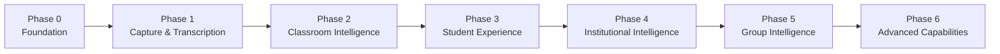

# Classroom Intelligence — Development Roadmap

## Update log

| Date       | Phase   | Update                                                                                                                                                                                                                                                                                                                                 |
| ---------- | ------- | -------------------------------------------------------------------------------------------------------------------------------------------------------------------------------------------------------------------------------------------------------------------------------------------------------------------------------------- |
| 2026-11-04 | Phase 0 | Monorepo skeleton created — all directories, root config, 4 apps, 17 services, 6 packages, hardware, infrastructure, data, docs and tests scaffolded.                                                                                                                                                                                  |
| 2026-11-04 | Phase 0 | **Phase 0 Complete** — Initial academic SQL schema (V001), ERD, CI/CD GitHub Actions workflows, ADR-001 through ADR-004, LGPD recording policy template, Terraform GCP modules (networking, storage, database, pubsub, iam, secrets), OpenAPI 3.1 specification, and AI/audio benchmark frameworks all implemented. Ready for Phase 1. |
| 2026-11-05 | Phases 1–6 | Cloud session handoff (branch `cloud-handoff`). Phases 1–4 implemented and tested; integration stage (Postgres, event bus, sync, internal auth) done per service; Phases 5–6 backend done, some UI/connectors WIP. See `HANDOFF.md`. |

> [!NOTE]
> This roadmap reflects the phased delivery plan derived from the product specification (`GENERAL.md`), engineering standards (`STANDARDS.md`) and UI-UX specification (`UI-UX.md`). Phases build on each other; no phase should be considered complete until its Definition of Done criteria are met.

---

## Status at cloud handoff (2026-11-05)

Legend: ✅ implemented and tested (in-memory + Postgres where applicable) · 🟡 in progress / partial (WIP commit) · ⬜ not started · 🔬 implemented but needs real-world/field validation.

| Phase | Status | Notes |
|---|---|---|
| 1 — Capture & Transcription | ✅ 1.1–1.18 · 🔬 | DoD items needing field data: physical device, WER on real corpus (no corpus yet), diarization on real rooms. Google STT adapter never executed. |
| 2 — Classroom Intelligence | ✅ 2.1–2.22 · 🔬 | Heuristic extractor eval: P/R 1.0 on 50 in-sample + 8 hold-out cases; LLM path not measured live. |
| 3 — Student Experience | ✅ 3.1–3.17 · 🔬 | WCAG: automated audit 60/60 against mocks; manual screen-reader pass pending. |
| 4 — Institutional Intelligence | ✅ 4.1–4.12 backend · 🟡 4.x admin UI reconciliation | Admin pages built; reconciliation with real backend shapes was in progress. |
| Integration stage | ✅ per-service Postgres, bus publishers, sync push, internal token · 🟡 dev bus, subscriptions, Terraform wiring, compose, e2e | Pending schema files in `data/migrations/pending/` still to be merged into `V005`. |
| 5 — Group Intelligence | ✅ 5.2–5.10 backend, 5.1 role (`group_executive`) · ⬜ 5.1 `/grupo` UI | BigQuery/Terraform never executed. |
| 6 — Advanced Capabilities | ✅ 6.1, 6.2, 6.3, 6.4 (transcription/search/structuring/extraction skip), 6.7, 6.8, 6.9, 6.10 · 🟡 6.5, 6.6 connectors, FLAC in ingestion/processing, language propagation | External APIs tested only with fixtures/fakes. |

The per-phase Definition of Done checklists below are kept as the acceptance target; items marked ✅ above are code-complete, items needing field validation remain unchecked until verified on real hardware/data.

---

## Phase 0 — Foundation & Validation

**Goal:** Establish the monorepo, validate the core technology choices, and produce the data model and API contracts before writing product code.

### Deliverables

| #    | Deliverable                                                                | Owner area      | Status  |
| ---- | -------------------------------------------------------------------------- | --------------- | ------- |
| 0.1  | Monorepo skeleton with tooling (Turbo, pnpm, ESLint, Prettier, TypeScript) | Infrastructure  | ✅ Done |
| 0.2  | Shared `@ci/types` package — full domain type definitions                  | Packages        | ✅ Done |
| 0.3  | Shared `@ci/schemas` package — Zod validation schemas for all AI outputs   | Packages        | ✅ Done |
| 0.4  | PostgreSQL academic data model (ERD + initial migrations)                  | Data            | ✅ Done |
| 0.5  | API contract design (OpenAPI 3.1 for all services)                         | API             | ✅ Done |
| 0.6  | Brazilian Portuguese transcription benchmark setup                         | Tests           | ✅ Done |
| 0.7  | Classroom acoustic test protocol and recording policy template             | Docs / Hardware | ✅ Done |
| 0.8  | Recording policy design (LGPD review)                                      | Governance      | ✅ Done |
| 0.9  | Infrastructure: GCP project, VPC, Secret Manager, Cloud KMS, Cloud Storage | Infrastructure  | ✅ Done |
| 0.10 | CI/CD pipeline (GitHub Actions: lint → typecheck → test → build)           | Infrastructure  | ✅ Done |
| 0.11 | Docker Compose local development environment                               | Infrastructure  | ✅ Done |
| 0.12 | Architecture Decision Records (ADRs) for key technology choices            | Docs            | ✅ Done |

### Definition of Done — Phase 0

- [x] Repository builds and all checks pass in CI. _(CI workflows in `.github/workflows/ci.yml`)_
- [x] Domain type definitions cover all entities from GENERAL.md §5. _(`@ci/types` — academic, capture, intelligence, governance)_
- [x] Zod schemas defined for all AI-generated structured outputs. _(`@ci/schemas` — events, recording, transcript)_
- [x] Database migrations produce a valid schema. _(`V001__initial_academic_schema.sql` + `ERD.md`)_
- [x] GCP infrastructure configured and documented. _(Terraform modules: networking, storage, database, pubsub, iam, secrets in `southamerica-east1`)_
- [x] Recording policy template reviewed against LGPD obligations. _(`docs/privacy/lgpd-recording-policy-template.md`)_
- [x] ADRs written for: primary transcription provider, database, AI gateway design, monorepo tooling. _(ADR-001 through ADR-004)_
- [x] API contract designed. _(OpenAPI 3.1 in `docs/architecture/openapi.yaml`)_
- [x] Audio & AI evaluation benchmark harnesses established. _(`tests/audio-evaluation/`, `tests/ai-evaluation/`)_

---

## Phase 1 — Capture & Transcription

**Goal:** A classroom device can be installed, registered, and begin capturing and transcribing real classes.

> [!IMPORTANT]
> This phase is the technical foundation of the entire product. No downstream AI module can be built without reliable audio capture and transcription.

### Deliverables

| #    | Deliverable                                                         | Service / Area                            |
| ---- | ------------------------------------------------------------------- | ----------------------------------------- |
| 1.1  | Device provisioning and secure registration                         | `device-management`                       |
| 1.2  | Device-to-classroom mapping and tenant association                  | `device-management`, `organization`       |
| 1.3  | Hardware identity (cryptographic device certificate)                | `device-management` / `hardware/firmware` |
| 1.4  | Scheduled recording start/stop (cron-based, policy-driven)          | `audio-ingestion`, `hardware/firmware`    |
| 1.5  | Encrypted audio upload with chunked transfer and integrity check    | `audio-ingestion`                         |
| 1.6  | Local audio buffer with automatic upload recovery                   | `hardware/firmware`                       |
| 1.7  | Recording metadata ingestion (device, classroom, timestamp, format) | `audio-ingestion`                         |
| 1.8  | Audio quality assessment (SNR, clipping, silence detection)         | `audio-processing`                        |
| 1.9  | Audio segmentation for long recordings                              | `audio-processing`                        |
| 1.10 | Brazilian Portuguese transcription via Google Cloud Speech / Chirp  | `transcription`                           |
| 1.11 | Transcript segment storage with timestamps and confidence scores    | `transcript-management`                   |
| 1.12 | Basic speaker diarization (speaker labels, not identity)            | `speaker-diarization`                     |
| 1.13 | Class identification from device + schedule + time                  | `academic-integration`                    |
| 1.14 | Academic schedule import (timetable, enrollments, professors)       | `academic-integration`                    |
| 1.15 | Institution and campus hierarchy setup                              | `organization`                            |
| 1.16 | Device health monitoring dashboard (admin)                          | `administration-web`                      |
| 1.17 | Recording failure alerting                                          | `audit`, `notifications`                  |
| 1.18 | Audit log for all recording lifecycle events                        | `audit`                                   |

### Definition of Done — Phase 1

- [ ] A physical device can be registered and associated with a classroom.
- [ ] A scheduled class triggers a recording start automatically.
- [ ] Audio is uploaded, checksummed and stored in Cloud Storage.
- [ ] A transcript with timestamped segments is produced for a 90-minute Brazilian Portuguese lecture.
- [ ] Word error rate on benchmark recordings meets target threshold.
- [ ] Speaker diarization produces labeled segments (without real-world identity).
- [ ] The recording is correctly associated with its class, course and professor.
- [ ] Device health metrics are visible to administrators.
- [ ] All recording lifecycle events are auditable.

---

## Phase 2 — Classroom Intelligence

**Goal:** Transcripts are transformed into structured, organized lecture materials and academic events are extracted.

> [!IMPORTANT]
> This is the core AI phase. Event extraction precision and date interpretation accuracy are critical — false positives on calendar events are unacceptable.

### Deliverables

| #    | Deliverable                                                              | Service / Area                             |
| ---- | ------------------------------------------------------------------------ | ------------------------------------------ |
| 2.1  | AI gateway with Gemini/Vertex AI integration, token and cost tracking    | `ai-gateway`                               |
| 2.2  | Prompt version control and evaluation instrumentation                    | `ai-gateway`                               |
| 2.3  | Lecture structuring: title, topic outline, definitions, Q&A              | `lecture-intelligence`                     |
| 2.4  | Executive lecture summary generation                                     | `lecture-intelligence`                     |
| 2.5  | Key concept and definition extraction                                    | `lecture-intelligence`                     |
| 2.6  | Reading reference extraction                                             | `lecture-intelligence`                     |
| 2.7  | Structured output validation for all LLM responses                       | `lecture-intelligence`, `event-extraction` |
| 2.8  | Academic event extraction (exams, assignments, deadlines, cancellations) | `event-extraction`                         |
| 2.9  | Relative date resolution against class date and academic calendar        | `event-extraction`                         |
| 2.10 | Ambiguous date and event flagging                                        | `event-extraction`                         |
| 2.11 | Event confidence scoring (multi-dimensional)                             | `event-extraction`                         |
| 2.12 | Event deduplication across repeated announcements                        | `event-extraction`                         |
| 2.13 | Event-to-course-and-student association                                  | `event-extraction`, `academic-integration` |
| 2.14 | Conflict detection with existing calendar events                         | `calendar`                                 |
| 2.15 | Announcement review queue — professor UI                                 | `professor-web`                            |
| 2.16 | Event confirmation, correction and rejection by professor                | `professor-web`, `event-extraction`        |
| 2.17 | Event publication workflow with configurable policy                      | `event-extraction`, `calendar`             |
| 2.18 | Transcript correction interface for professors                           | `professor-web`, `transcript-management`   |
| 2.19 | Transcript correction versioning (original preserved)                    | `transcript-management`                    |
| 2.20 | Event extraction evaluation dataset (precision / recall)                 | `tests/ai-evaluation`                      |
| 2.21 | Hallucination prevention validation rules                                | `event-extraction`, `lecture-intelligence` |
| 2.22 | Prompt injection protection for all transcript-sourced input             | `ai-gateway`                               |

### Definition of Done — Phase 2

- [ ] A lecture transcript produces a structured summary with topics, definitions and Q&A.
- [ ] An examination and an assignment deadline announced during class are extracted correctly.
- [ ] Relative dates ("next Monday", "in two weeks") resolve correctly against the class calendar.
- [ ] Ambiguous events are held for professor review and not auto-published.
- [ ] A professor can confirm, edit or reject an extracted announcement via the web interface.
- [ ] Confirmed events are published with full source provenance (recording, segment, timestamp).
- [ ] Deduplication correctly identifies repeated announcements.
- [ ] Event extraction precision and recall meet defined thresholds on the evaluation dataset.
- [ ] AI explanations are never presented as direct professor statements.

---

## Phase 3 — Student Experience

**Goal:** Students have a complete, polished academic companion — lecture archive, calendar, notifications and AI assistant.

### Deliverables

| #    | Deliverable                                                            | Service / Area                                  |
| ---- | ---------------------------------------------------------------------- | ----------------------------------------------- |
| 3.1  | Student authentication and enrollment-based access control             | `identity`, `student-web`                       |
| 3.2  | Student home — upcoming events, recent classes, announcements          | `student-web`                                   |
| 3.3  | Lecture library with search, filters and sorting                       | `student-web`                                   |
| 3.4  | Lecture detail page — summary, outline, concepts, Q&A, announcements   | `student-web`                                   |
| 3.5  | Transcript viewer with timestamp navigation and topic markers          | `student-web`                                   |
| 3.6  | Semantic search across lecture archive                                 | `transcript-management`, `lecture-intelligence` |
| 3.7  | Student academic calendar — month, week and agenda views               | `student-web`, `calendar`                       |
| 3.8  | Calendar event status and source inspection                            | `student-web`, `calendar`                       |
| 3.9  | Deadline change history visible to students                            | `calendar`                                      |
| 3.10 | Calendar export and external calendar synchronization                  | `calendar`                                      |
| 3.11 | Student notification system (push, email, in-app)                      | `notifications`                                 |
| 3.12 | Configurable notification preferences                                  | `student-web`, `notifications`                  |
| 3.13 | AI Academic Assistant — question answering grounded in lecture content | `student-web`, `lecture-intelligence`           |
| 3.14 | Assistant source citations (class, timestamp, transcript passage)      | `student-web`, `lecture-intelligence`           |
| 3.15 | Report incorrect information workflow                                  | `student-web`, `audit`                          |
| 3.16 | Mobile-optimized student experience                                    | `student-web`                                   |
| 3.17 | WCAG 2.2 AA accessibility audit                                        | `student-web`                                   |

### Definition of Done — Phase 3

- [ ] A student can log in and see only their enrolled classes.
- [ ] Recent class summaries appear on the home screen.
- [ ] A student can open a lecture, read the summary and navigate to the transcript.
- [ ] A student can search lecture content and find relevant passages.
- [ ] Academic calendar shows examinations and assignments with source and status.
- [ ] A student is notified when an announcement is published or a deadline changes.
- [ ] The AI assistant answers questions and cites the relevant class and transcript passage.
- [ ] The assistant never presents AI explanations as professor statements.
- [ ] The experience is usable on mobile.

---

## Phase 4 — Institutional Intelligence

**Goal:** Academic coordinators and campus administrators have operational visibility across courses, classes and devices.

### Deliverables

| #    | Deliverable                                                                | Service / Area                             |
| ---- | -------------------------------------------------------------------------- | ------------------------------------------ |
| 4.1  | Academic coordinator workspace                                             | `administration-web`                       |
| 4.2  | Curriculum coverage — syllabus vs. detected topics                         | `academic-analytics`                       |
| 4.3  | Assessment calendar — institutional consolidated view                      | `academic-analytics`, `administration-web` |
| 4.4  | Conflict detection across courses and assessment dates                     | `calendar`, `academic-analytics`           |
| 4.5  | Professor adoption and class-level analytics                               | `academic-analytics`                       |
| 4.6  | Campus overview — capture coverage, failures, processing status            | `administration-web`                       |
| 4.7  | Device management console — fleet view, status, diagnostics                | `administration-web`, `device-management`  |
| 4.8  | Capture incident queue with severity and resolution tracking               | `administration-web`, `audit`              |
| 4.9  | Operational reports — capture coverage, transcription success, corrections | `academic-analytics`                       |
| 4.10 | Recording governance console — policies, consent, audit                    | `administration-web`                       |
| 4.11 | LGPD data subject rights workflow                                          | `identity`, `organization`                 |
| 4.12 | Retention policy enforcement and deletion workflows                        | `organization`, `audit`                    |

### Definition of Done — Phase 4

- [ ] An administrator can see capture coverage across all classrooms.
- [ ] A coordinator can compare syllabus coverage against detected lecture topics.
- [ ] Assessment conflicts across courses are highlighted.
- [ ] Device incidents are tracked from detection to resolution.
- [ ] Recording policies are enforced and auditable.
- [ ] Retention-triggered deletion workflows operate correctly.

---

## Phase 5 — Group Intelligence

**Goal:** Holding-company executives have cross-institutional visibility into academic operations, adoption and cost.

### Deliverables

| #    | Deliverable                                                                | Service / Area                             |
| ---- | -------------------------------------------------------------------------- | ------------------------------------------ |
| 5.1  | Group Intelligence workspace and authentication                            | `administration-web`, `identity`           |
| 5.2  | Group overview — all institutions, capture and adoption at a glance        | `group-intelligence`                       |
| 5.3  | Institutional comparison dashboards (contextualized)                       | `group-intelligence`                       |
| 5.4  | Academic intelligence indicators across institutions                       | `group-intelligence`, `academic-analytics` |
| 5.5  | Operational intelligence — hardware fleet, uptime, cost per captured class | `group-intelligence`                       |
| 5.6  | Executive natural-language investigation interface                         | `group-intelligence`                       |
| 5.7  | BigQuery analytical pipeline for aggregated reporting                      | `group-intelligence`, infrastructure       |
| 5.8  | Cross-institution adoption analytics                                       | `group-intelligence`                       |
| 5.9  | Per-institution, per-campus cost dashboards                                | `group-intelligence`                       |
| 5.10 | AI usage and cost tracking across the group                                | `ai-gateway`, `group-intelligence`         |

### Definition of Done — Phase 5

- [ ] An executive can see capture and adoption metrics for all institutions.
- [ ] Institutional comparisons include contextual notes on structural differences.
- [ ] Cost per captured class is calculated and displayed per institution.
- [ ] The executive investigation interface answers questions citing data provenance and limitations.
- [ ] No individual student data is exposed in aggregated executive views.

---

## Phase 6 — Advanced Capabilities

**Goal:** Deepen AI quality, expand integrations and add personalization features.

### Deliverables

| #    | Deliverable                                                   | Area                                     |
| ---- | ------------------------------------------------------------- | ---------------------------------------- |
| 6.1  | Improved speaker diarization (multi-turn, overlapping speech) | `speaker-diarization`                    |
| 6.2  | Personalized revision materials per student                   | `lecture-intelligence`, `student-web`    |
| 6.3  | Advanced semantic lecture search with concept linking         | `transcript-management`                  |
| 6.4  | Additional language support beyond Portuguese                 | `transcription`                          |
| 6.5  | SIS integration (Totvs, Banner, Ellucian)                     | `academic-integration`                   |
| 6.6  | LMS integration (Moodle, Canvas, Blackboard)                  | `academic-integration`                   |
| 6.7  | Advanced learning pattern analytics                           | `academic-analytics`                     |
| 6.8  | AI evaluation framework with automated regression testing     | `tests/ai-evaluation`                    |
| 6.9  | Expanded external calendar integrations                       | `calendar`                               |
| 6.10 | Hardware second-generation device support                     | `hardware/firmware`, `device-management` |

---

## MVP Acceptance Checklist

> [!IMPORTANT]
> The MVP is the intersection of Phases 1, 2 and 3. It must demonstrate the full end-to-end workflow described in GENERAL.md §10.

- [ ] A classroom device is installed and registered.
- [ ] A scheduled class is captured automatically.
- [ ] The recording is associated with the correct course.
- [ ] The recording is transcribed in Brazilian Portuguese.
- [ ] The lecture is structured into summary, topics and concepts.
- [ ] An examination date and an assignment deadline are extracted.
- [ ] A conflict with existing calendar information is detected and flagged.
- [ ] The professor confirms the events via the review interface.
- [ ] Confirmed events are published with source provenance preserved.
- [ ] Relevant students receive calendar entries and notifications.
- [ ] Students can search and review previous class content.
- [ ] Administrators can monitor capture performance.
- [ ] All relevant actions produce auditable records.
- [ ] Recording and access policies are enforced throughout.

---

## Skeleton Status

| Area                                                                       | Status                                                         |
| -------------------------------------------------------------------------- | -------------------------------------------------------------- |
| Repository structure                                                       | ✅ Created                                                     |
| Root config (pnpm, Turbo, ESLint, Prettier, TypeScript)                    | ✅ Created                                                     |
| `apps/*` (student-web, professor-web, administration-web, api)             | ✅ Scaffolded                                                  |
| `services/*` (17 services)                                                 | ✅ Scaffolded                                                  |
| `packages/*` (types, schemas, ui, shared-config, api-client, academic-sdk) | ✅ Scaffolded                                                  |
| `hardware/*`                                                               | ✅ Scaffolded                                                  |
| `infrastructure/*` (Terraform, Docker Compose)                             | ✅ GCP Modules (Networking, Storage, DB, PubSub, IAM, Secrets) |
| `data/*` (model, migrations, seed, reference)                              | ✅ V001 Migration + ERD + Documentation Created                |
| `docs/*`                                                                   | ✅ ADRs (001-004), Architecture & LGPD Policy Created          |
| `tests/*`                                                                  | ✅ Benchmark Runner + Evaluation Cases Scaffolded              |
| `ROADMAP.md` in project root                                               | ✅ Phase 0 Complete — Updated 2026-11-04                       |
