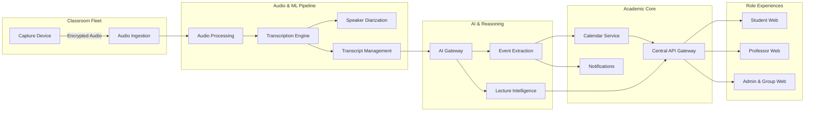

# Classroom Intelligence — System Architecture

This directory outlines the technical architecture, component interactions, service boundaries, and design records for the Classroom Intelligence platform.

---

## 1. System Overview

Classroom Intelligence transforms live academic lectures into verified, actionable academic intelligence through a multi-stage physical-to-digital pipeline.

---

## 2. Port Map & Service Directory

| Service / App | Directory | Runtime / Tech | Default Port | Description |
|---|---|---|---|---|
| **student-web** | `apps/student-web` | Next.js 15 (React 19) | `3000` | Student portal, study companion, calendar |
| **professor-web** | `apps/professor-web` | Next.js 15 (React 19) | `3001` | Review queue, corrections, course overview |
| **administration-web** | `apps/administration-web`| Next.js 15 (React 19) | `3002` | Fleet monitoring, campus admin & group intelligence |
| **api** | `apps/api` | TypeScript (Fastify 5) | `4000` | BFF and unified application REST gateway |
| **identity** | `services/identity` | TypeScript (Fastify 5) | `4001` | Auth, MFA, RBAC, SSO, JWT issuance |
| **organization** | `services/organization` | TypeScript (Fastify 5) | `4002` | Holding, institution, and campus hierarchy |
| **academic-integration** | `services/academic-integration` | TypeScript (Fastify 5) | `4003` | SIS/LMS synchronization and timetable mapping |
| **device-management** | `services/device-management` | TypeScript (Fastify 5) | `4004` | IoT device registry, telemetry, health metrics |
| **calendar** | `services/calendar` | TypeScript (Fastify 5) | `4005` | Student and institutional calendar operations |
| **notifications** | `services/notifications` | TypeScript (Fastify 5) | `4006` | Multi-channel dispatch (push, email, in-app) |
| **transcript-management** | `services/transcript-management` | TypeScript (Fastify 5) | `4008` | Versioned transcript store and corrections |
| **academic-analytics** | `services/academic-analytics` | TypeScript (Fastify 5) | `4009` | Course- and campus-level delivery indicators |
| **group-intelligence** | `services/group-intelligence` | TypeScript (Fastify 5) | `4010` | Cross-institution executive dashboards |
| **audit** | `services/audit` | TypeScript (Fastify 5) | `4011` | Immutable audit logging and compliance tracking |
| **audio-ingestion** | `services/audio-ingestion` | Python 3.12 (FastAPI) | `4101` | Device chunk upload and checksum validation |
| **audio-processing** | `services/audio-processing` | Python 3.12 (FastAPI) | `4102` | Quality scoring, normalization, segmentation |
| **transcription** | `services/transcription` | Python 3.12 (FastAPI) | `4103` | Brazilian Portuguese speech-to-text pipeline |
| **speaker-diarization** | `services/speaker-diarization` | Python 3.12 (FastAPI) | `4104` | Speaker turn clustering and labeling |
| **lecture-intelligence** | `services/lecture-intelligence` | Python 3.12 (FastAPI) | `4105` | Summaries, concept extraction, Q&A synthesis |
| **event-extraction** | `services/event-extraction` | Python 3.12 (FastAPI) | `4106` | High-precision exam/deadline extraction & date resolution |
| **ai-gateway** | `services/ai-gateway` | Python 3.12 (FastAPI) | `4107` | Centralized LLM gateway, schema validation, cost tracker |

---

## 3. Architecture Decision Records (ADRs)

- [ADR-001: Monorepo Tooling & Workspace Strategy](file:///c:/Users/fred/Downloads/hackathon2/classroom-intelligence/docs/architecture/adr/ADR-001-monorepo-tooling.md)
- [ADR-002: Operational and Analytical Data Architecture](file:///c:/Users/fred/Downloads/hackathon2/classroom-intelligence/docs/architecture/adr/ADR-002-database.md)
- [ADR-003: Centralized AI Gateway and LLM Orchestration](file:///c:/Users/fred/Downloads/hackathon2/classroom-intelligence/docs/architecture/adr/ADR-003-ai-gateway.md)
- [ADR-004: Primary Speech-to-Text Infrastructure](file:///c:/Users/fred/Downloads/hackathon2/classroom-intelligence/docs/architecture/adr/ADR-004-transcription-provider.md)

---

## 4. API Contract

The unified API specification for `apps/api` is documented in [OpenAPI 3.1 format](file:///c:/Users/fred/Downloads/hackathon2/classroom-intelligence/docs/architecture/openapi.yaml).
