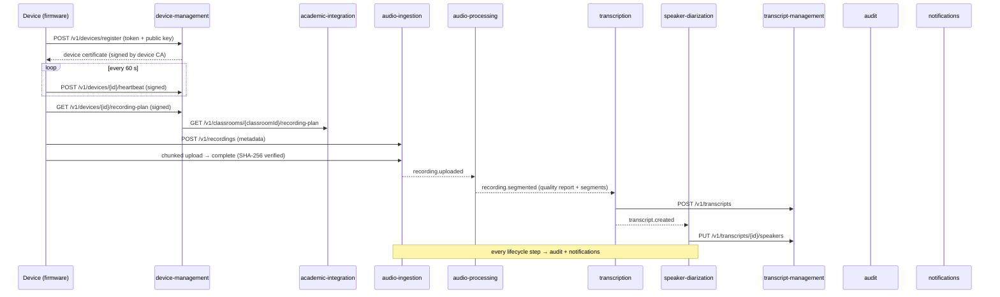

# Phase 1 — Capture & Transcription Pipeline (Contracts)

This document is the **shared contract** for every Phase 1 component. Services own
their storage, but the identifiers, event names, payloads and authentication
scheme below are fixed across the platform.

## 1. Component map

| Component                        | Lang           | Port | Phase 1 deliverables                                                             |
| -------------------------------- | -------------- | ---- | -------------------------------------------------------------------------------- |
| `services/organization`          | TS / Fastify   | 4002 | 1.2, 1.15 — hierarchy, classrooms, recording policies                            |
| `services/academic-integration`  | TS / Fastify   | 4003 | 1.13, 1.14 — schedule import, class identification, recording plan               |
| `services/device-management`     | TS / Fastify   | 4004 | 1.1, 1.2, 1.3 — provisioning, certificates, assignment, heartbeats, fleet health |
| `services/notifications`         | TS / Fastify   | 4006 | 1.17 — failure alert rules, incidents, delivery                                  |
| `services/transcript-management` | TS / Fastify   | 4008 | 1.11 — transcript and segment storage                                            |
| `services/audit`                 | TS / Fastify   | 4011 | 1.18 — append-only, hash-chained audit log                                       |
| `services/audio-ingestion`       | Py / FastAPI   | 8001 | 1.5, 1.7 — recording metadata, chunked encrypted upload                          |
| `services/audio-processing`      | Py / FastAPI   | 8002 | 1.8, 1.9 — quality assessment, segmentation                                      |
| `services/transcription`         | Py / FastAPI   | 8003 | 1.10 — pt-BR STT (Google Chirp 2)                                                |
| `services/speaker-diarization`   | Py / FastAPI   | 8004 | 1.12 — anonymous speaker labels                                                  |
| `hardware/firmware`              | Py (Linux SBC) | —    | 1.3, 1.4, 1.6 — device agent                                                     |
| `apps/administration-web`        | Next.js        | 3002 | 1.16 — device health dashboard                                                   |



## 2. Identifiers

All IDs are UUID v4 strings. Timestamps are ISO 8601 with offset (`2026-11-04T19:00:00.000Z`).
Durations and offsets inside audio are integer **milliseconds**.

## 3. Device identity & request signing (1.3)

- Each device generates an **Ed25519** key pair on first boot; the private key never leaves the device
  (`/var/lib/ci-agent/identity/device.key`, mode `0600`).
- Registration: `POST /v1/devices/register`
  ```json
  {
    "provisioningToken": "pt_…",
    "serialNumber": "CI-A1-000123",
    "model": "ci-capture-a1",
    "firmwareVersion": "1.0.0",
    "publicKeyPem": "-----BEGIN PUBLIC KEY-----…"
  }
  ```
  The token is single-use, expires (default 72 h), is bound to the serial number and is stored only as a
  SHA-256 hash. Response `201`:
  ```json
  {
    "deviceId": "…",
    "certificate": "<base64url(payload)>.<base64url(signature)>",
    "certificatePayload": {
      "v": 1,
      "deviceId": "…",
      "serialNumber": "…",
      "institutionId": "…",
      "publicKeyFingerprint": "sha256:<hex>",
      "issuedAt": "…",
      "expiresAt": "…",
      "issuer": "ci-device-ca"
    }
  }
  ```
  The certificate is signed with the device CA Ed25519 key (`DEVICE_CA_PRIVATE_KEY_PEM`, from Secret Manager).
  Certificates are valid for 365 days and can be revoked (`POST /v1/devices/{id}/revoke`).
- **Signed requests** — every device→cloud call carries:

  | Header               | Value                                              |
  | -------------------- | -------------------------------------------------- |
  | `X-Device-Id`        | device UUID                                        |
  | `X-Device-Timestamp` | ISO 8601 UTC, must be within ±300 s of server time |
  | `X-Device-Signature` | base64 Ed25519 signature of the canonical string   |

  Canonical string (UTF-8, `\n` separated, no trailing newline):

  ```
  CI-DEVICE-V1
  <HTTP METHOD uppercase>
  <path including query string>
  <X-Device-Timestamp>
  <lowercase hex SHA-256 of the raw request body (empty body → hash of empty string)>
  ```

- Services other than device-management verify signatures using
  `GET /internal/v1/devices/{id}/public-key` → `{ "deviceId", "publicKeyPem", "status", "classroomId", "institutionId" }`
  (`404` unknown, `status: "revoked" | "decommissioned"` must be rejected).

## 4. Recording plan (1.4)

`GET /v1/classrooms/{classroomId}/recording-plan?from=<iso>&to=<iso>` (academic-integration), proxied for devices by
`GET /v1/devices/{deviceId}/recording-plan` (device-management, signed):

```json
{
  "classroomId": "…",
  "generatedAt": "…",
  "timezone": "America/Sao_Paulo",
  "windows": [
    {
      "scheduledClassId": "…",
      "classSectionId": "…",
      "courseId": "…",
      "professorId": "…",
      "startsAt": "…",
      "endsAt": "…",
      "recordStartAt": "…",
      "recordStopAt": "…",
      "recordingPolicyId": "…",
      "recordingEnabled": true
    }
  ]
}
```

`recordStartAt = startsAt − policy.preRollMinutes`, `recordStopAt = endsAt + policy.postRollMinutes`.
Cancelled classes are excluded; `recordingEnabled=false` windows are kept so the device can show why it is not recording.

## 5. Upload protocol (1.5, 1.6, 1.7)

1. `POST /v1/recordings` (signed) — metadata, returns `recordingSessionId`:
   ```json
   { "deviceId", "classroomId", "scheduledClassId?", "startedAt", "endedAt",
     "audioFormat": "wav_pcm_s16le", "sampleRate": 16000, "channels": 1,
     "fileSizeBytes", "checksumSha256", "firmwareVersion", "localRecordingId" }
   ```
   `localRecordingId` makes the call idempotent per device.
2. `POST /v1/uploads` `{ recordingSessionId, totalSizeBytes, checksumSha256, chunkSizeBytes }` → `{ uploadId, totalChunks, receivedChunks: [] }`
   (an existing incomplete upload for the same recording is returned instead of a new one — resume).
3. `PUT /v1/uploads/{uploadId}/chunks/{index}` raw body, header `X-Chunk-SHA256` → `204`. Re-sending an identical chunk is a no-op.
4. `GET /v1/uploads/{uploadId}` → status + `receivedChunks` for resume.
5. `POST /v1/uploads/{uploadId}/complete` → assembles, verifies whole-file SHA-256, stores encrypted
   (AES-256-GCM locally / CMEK in GCS) at `recordings/{institutionId}/{yyyy}/{mm}/{dd}/{recordingSessionId}.wav`,
   publishes `recording.uploaded`. Mismatch → `422`, upload marked `failed`, `upload.failed` emitted.

Default chunk size 4 MiB; max 16 MiB.

## 6. Events (Pub/Sub topic = event name)

Envelope (all events):

```json
{ "eventId": "uuid", "type": "recording.uploaded", "version": 1, "occurredAt": "…",
  "source": "audio-ingestion", "institutionId": "…", "data": { … } }
```

| Event                                              | Producer             | `data`                                                                                                                                  |
| -------------------------------------------------- | -------------------- | --------------------------------------------------------------------------------------------------------------------------------------- |
| `device.registered`                                | device-management    | `deviceId, serialNumber`                                                                                                                |
| `device.assigned`                                  | device-management    | `deviceId, classroomId, previousClassroomId?`                                                                                           |
| `device.heartbeat_missed`                          | device-management    | `deviceId, classroomId, lastSeenAt`                                                                                                     |
| `recording.started` / `recording.stopped`          | firmware → ingestion | `deviceId, localRecordingId, scheduledClassId?, at`                                                                                     |
| `recording.missed`                                 | notifications (rule) | `scheduledClassId, classroomId, deviceId?`                                                                                              |
| `recording.uploaded`                               | audio-ingestion      | `recordingSessionId, deviceId, classroomId, scheduledClassId?, storageUri, sizeBytes, checksumSha256, sampleRate, channels, durationMs` |
| `upload.failed`                                    | audio-ingestion      | `recordingSessionId, uploadId, reason`                                                                                                  |
| `audio.quality_assessed`                           | audio-processing     | `recordingSessionId, report` (see §7)                                                                                                   |
| `recording.segmented`                              | audio-processing     | `recordingSessionId, segments: [{index, startMs, endMs, storageUri}]`                                                                   |
| `transcription.completed` / `transcription.failed` | transcription        | `recordingSessionId, transcriptId? , reason?`                                                                                           |
| `diarization.completed`                            | speaker-diarization  | `transcriptId, speakerCount`                                                                                                            |

## 7. Audio quality report (1.8)

```json
{ "durationMs", "sampleRate", "channels",
  "rmsDbfs", "peakDbfs", "noiseFloorDbfs", "snrDb",
  "clippingRatio", "silenceRatio", "longestSilenceMs",
  "score": 0.0-1.0, "verdict": "good" | "acceptable" | "poor" | "unusable",
  "issues": ["clipping" | "low_snr" | "excessive_silence" | "too_quiet" | "too_short"] }
```

Thresholds: clipping > 0.1 % of samples, SNR < 15 dB, silence > 60 %, RMS < −45 dBFS, duration < 60 s.
`unusable` stops the pipeline (no transcription) and raises a `poor_audio_quality` incident.

## 8. Transcript segment (1.11)

```json
{
  "segmentIndex": 0,
  "startMs": 0,
  "endMs": 4200,
  "text": "Bom dia, turma.",
  "confidence": 0.94,
  "language": "pt-BR",
  "speakerLabel": "SPEAKER_1",
  "words": [{ "word": "Bom", "startMs": 0, "endMs": 300, "confidence": 0.98 }]
}
```

Segments are ordered by `startMs`, non-overlapping, `0 ≤ confidence ≤ 1`. Speaker labels are
`SPEAKER_<n>` — **never** a real-world identity (LGPD; GENERAL.md privacy principles).

## 9. Audit action catalog (1.18)

`device.provisioning_token_created`, `device.registered`, `device.assigned`, `device.unassigned`,
`device.certificate_revoked`, `device.status_changed`, `recording.scheduled`, `recording.started`,
`recording.stopped`, `recording.missed`, `recording.metadata_received`, `upload.started`,
`upload.completed`, `upload.failed`, `audio.quality_assessed`, `audio.segmented`,
`transcription.started`, `transcription.completed`, `transcription.failed`,
`diarization.completed`, `recording.class_identified`, `alert.raised`, `alert.acknowledged`, `alert.resolved`.

## 10. Alert rules (1.17)

| Rule                    | Trigger                                                               | Severity                   |
| ----------------------- | --------------------------------------------------------------------- | -------------------------- |
| `device_offline`        | no heartbeat for 3 min (5 min outside class windows: `low`)           | high during a class window |
| `recording_missed`      | class window started +5 min and no `recording.started` for that class | high                       |
| `failed_upload`         | `upload.failed` or upload not complete 2 h after `recordStopAt`       | medium                     |
| `poor_audio_quality`    | quality verdict `poor` (medium) / `unusable` (high)                   | medium / high              |
| `transcription_failure` | `transcription.failed`                                                | medium                     |
| `low_storage`           | heartbeat `diskFreeBytes` < 1 GiB                                     | medium                     |

Alerts are deduplicated by `(rule, resourceId)` while open and re-notified at most every 30 min.
