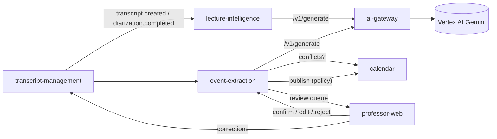

# Phase 2 — Classroom Intelligence (Contracts)

Shared contract for every Phase 2 component. Builds on
[`phase-1-capture-pipeline.md`](./phase-1-capture-pipeline.md) (IDs, envelope, audit catalog, segment format).

## 1. Component map

| Component | Lang | Port | Deliverables |
|---|---|---|---|
| `services/ai-gateway` | Py / FastAPI | 8005 | 2.1, 2.2, 2.22 |
| `services/lecture-intelligence` | Py / FastAPI | 8006 | 2.3–2.7, 2.21 |
| `services/event-extraction` | Py / FastAPI | 8007 | 2.7–2.13, 2.16, 2.17, 2.21 |
| `services/calendar` | TS / Fastify | 4005 | 2.14, 2.17 |
| `services/transcript-management` | TS / Fastify | 4008 | 2.18, 2.19 |
| `apps/professor-web` | Next.js | 3001 | 2.15, 2.16, 2.18 |
| `tests/ai-evaluation` | Py | — | 2.20 |



## 2. AI gateway (2.1, 2.2, 2.22)

`POST /v1/generate`
```json
{ "task": "lecture_structuring" | "event_extraction" | "date_resolution",
  "promptId": "event-extraction", "promptVersion": "2026-11-04.1",   // optional → active version
  "variables": { "classDate": "2026-11-04", "courseName": "…" },
  "untrustedInputs": { "transcript": "[s12 00:41:02] …" },              // never placed in system prompt
  "responseSchema": { …JSON Schema… },
  "institutionId": "uuid", "requestedBy": "event-extraction",
  "options": { "temperature": 0, "maxOutputTokens": 4096 } }
```
Response `200`:
```json
{ "requestId": "uuid", "output": { … schema-valid JSON … },
  "model": { "provider": "vertex", "name": "gemini-2.5-flash" },
  "prompt": { "id": "event-extraction", "version": "2026-11-04.1", "sha256": "…" },
  "usage": { "inputTokens": 1234, "outputTokens": 321, "costUsd": 0.00042 },
  "latencyMs": 812, "attempts": 1,
  "safety": { "injectionSuspected": false, "injectionSignals": [] } }
```
Errors: `422 schema_validation_failed` (after one corrective retry), `429 budget_exceeded`
(per-institution monthly USD budget), `502 provider_error`.

* Prompts live in `services/ai-gateway/prompts/<promptId>/<version>.yaml` (system, user template, task,
  model, temperature, changelog). `GET /v1/prompts`, `GET /v1/prompts/{id}` list versions; the active
  version is set in `prompts/<promptId>/active`.
* Every call is recorded (`GET /v1/usage?institutionId&from&to` aggregates tokens and cost by task/model/prompt
  version; `GET /v1/calls/{requestId}` returns the instrumentation record — prompt hash, variables hash,
  latency, attempts, validation outcome). Raw transcript text is **not** stored in call records.
* Prompt-injection defence: untrusted inputs are wrapped in `<untrusted_classroom_transcript>` delimiters
  inside the user turn with a standing instruction that it is data; delimiter look-alikes are escaped;
  heuristic detector (pt-BR + en: "ignore as instruções", "ignore all previous", "system prompt",
  "você agora é", role tags, delimiter spoofing) sets `safety.injectionSuspected`. Callers must treat
  suspected-injection output as requiring human review (never auto-publish).
* Providers: `vertex` (google-genai / Vertex AI, lazy import, extra `gcp`) and `fake` (deterministic,
  scripted fixtures; default in dev/tests). Pricing table per model in config.

## 3. Lecture structure (2.3–2.6)

`POST /v1/lectures/structure` `{ transcriptId, scheduledClassId, courseName?, language, segments: [§8 segment] }`
→ `LectureStructure`:
```json
{ "lectureSummaryId": "uuid", "transcriptId", "scheduledClassId",
  "title": "…", "executiveSummary": "…",
  "topics": [{ "order": 1, "title": "…", "description": "…", "startMs", "endMs",
               "segmentIndexes": [3,4,5], "subtopics": [ …same shape… ] }],
  "concepts": [{ "term": "…", "definition": "…", "example?": "…", "segmentIndexes": [12] }],
  "questions": [{ "question": "…", "answer?": "…", "askedBy": "student|professor|unknown", "segmentIndexes": [40] }],
  "readingReferences": [{ "title": "…", "authors?": "…", "type": "book|article|chapter|website|other", "segmentIndexes": [55] }],
  "validation": { "droppedItems": 2, "flags": [{ "path": "concepts[3]", "reason": "ungrounded" }] },
  "provenance": { "promptId", "promptVersion", "model", "processingVersion" } }
```
`GET /v1/lectures/{scheduledClassId}` returns the latest structure.

## 4. Extracted event (2.8–2.13)

```json
{ "id": "uuid", "type": "examination|quiz|assignment|project|presentation|reading_deadline|class_cancellation|class_reschedule|room_change|other",
  "title": "Prova 2 — capítulos 4 a 7", "description?": "…",
  "institutionId", "courseId", "classSectionId", "scheduledClassId", "transcriptId",
  "eventDate": "2026-11-20" | null, "eventTime": "19:00" | null, "timezone": "America/Sao_Paulo",
  "dateExpression": "dia 20 de novembro", "dateResolution": { "method": "absolute|relative|next_class|weekday|none",
     "ambiguous": false, "candidates": ["2026-11-20"], "explanation": "…" },
  "source": { "recordingSessionId", "segmentIndex": 42, "startMs": 2461000, "endMs": 2468500,
              "quote": "nossa segunda prova será no dia 20 de novembro" },
  "confidence": { "overall", "transcription", "eventClassification", "dateInterpretation", "courseAssociation" },
  "flags": ["ambiguous_date" | "hypothetical" | "past_date" | "injection_suspected" | "low_transcription_confidence" | "conflict" | "duplicate_of:<id>"],
  "confirmationStatus": "suggested|awaiting_professor|awaiting_admin|confirmed|published|rejected",
  "duplicateOf": "uuid" | null, "mentions": [{ "scheduledClassId", "segmentIndex", "quote" }],
  "conflicts": [ §6 conflict ], "changeHistory": [{ "changedAt", "changedBy", "source", "field", "previousValue", "newValue", "reason?" }],
  "provenance": { "extractor": "llm|heuristic", "promptVersion?", "model?", "processingVersion" } }
```

* `overall = min(transcription, eventClassification, dateInterpretation, courseAssociation)` weighted:
  `0.4·min + 0.6·geometric mean` — a single weak dimension always pulls the score down.
* Date resolution is deterministic code (not the LLM) against `classDate`, the campus timezone, and the
  section's upcoming scheduled classes (for "na próxima aula"). Ambiguous expressions
  ("lá para o final do mês", "mês que vem", "depois do feriado") → `eventDate: null`, `ambiguous: true`.
* **Hallucination rules (2.21):** the `quote` must be found (accent/case/punctuation-insensitive) in the
  cited segment text; the date expression must appear in the quote or its neighbouring segment; event type
  must be supported by a keyword family in the quote; hypothetical/conditional mood ("se a prova fosse")
  is rejected; anything failing is dropped and counted in validation stats.
* **Dedup (2.12):** same `classSectionId` + `type` + (same `eventDate`, or both null with title similarity
  ≥ 0.8) → merged into the earliest event; the later one is recorded in `mentions`. A repeated
  announcement with a **different** date for the same assessment becomes a `date_change` proposal on the
  existing event (never a silent overwrite).

## 5. Review & publication (2.15–2.17)

* Publication policy per institution: `{ autoPublish: boolean, autoPublishMinConfidence: 0.92,
  allowAutoPublishTypes: ["examination", …], requireProfessorReviewFor: ["class_cancellation"] }`.
  Auto-publish only if policy allows **and** overall ≥ threshold **and** no flags **and** no conflicts.
  Otherwise status `awaiting_professor`.
* Professor endpoints (event-extraction):
  `GET /v1/review-queue?professorId&status` · `GET /v1/events/{id}` ·
  `POST /v1/events/{id}/confirm {actorId, notes?}` · `POST /v1/events/{id}/edit {actorId, changes:{title?, type?, eventDate?, eventTime?, description?}, reason?}` (implies confirm) ·
  `POST /v1/events/{id}/reject {actorId, reason}` · `POST /v1/events/{id}/publish {actorId}`.
  Only the section's professor (or an admin) may act (`X-Actor-Id`, `X-Actor-Role` headers until identity lands in Phase 3).
* Publishing calls calendar `POST /v1/calendar-events` with full provenance; status → `published`.

## 6. Calendar (2.14, 2.17)

* `POST /v1/calendar-events` `{ institutionId, courseId, classSectionId, extractedEventId?, type, title, description?, eventDate, eventTime?, timezone, isOfficial, provenance: { recordingSessionId, transcriptId, segmentIndex, startMs, endMs, quote, confirmedBy, confirmedAt } }` → `201`.
  Re-publishing the same `extractedEventId` updates the event and appends a change record.
* `GET /v1/calendar-events?classSectionId&courseId&institutionId&from&to`, `GET /v1/calendar-events/{id}` (with history).
* `POST /v1/conflicts/check` `{ institutionId, classSectionId, type, eventDate, eventTime?, excludeEventId? }` →
  `{ conflicts: [{ kind, severity: "info|warning|blocking", message, relatedEventId? }] }`, kinds:
  `same_section_same_day`, `assessment_overlap_shared_students` (other sections sharing ≥ 1 enrolled student
  with an assessment on the same day), `assessment_load` (a student with ≥ 3 assessments in 7 days),
  `non_teaching_day` (institutional holiday / outside term), `existing_event_different_date`
  (same section + type already scheduled on another date).
* Enrollment/section overlap data via `POST /v1/sections` / `POST /v1/enrollments/bulk` sync endpoints
  (fed by academic-integration) and holidays via `POST /v1/non-teaching-days`.

## 7. Transcript corrections (2.18, 2.19)

`POST /v1/transcripts/{id}/segments/{segmentIndex}/corrections { correctedText, correctedBy, reason? }`
creates a new version: the original text is never mutated; segment `correctionStatus` → `corrected`,
`text` serves the latest version, `originalText` is preserved. `GET …/corrections` lists versions,
`GET /v1/transcripts/{id}?version=original` serves the untouched machine transcript. Emits audit
`transcript.corrected` and event `transcript.corrected` (downstream re-extraction may be triggered).

## 8. Events (Phase 2 additions)

| Event | Producer | `data` |
|---|---|---|
| `lecture.structured` | lecture-intelligence | `scheduledClassId, transcriptId, lectureSummaryId` |
| `events.extracted` | event-extraction | `transcriptId, scheduledClassId, eventIds, awaitingReview` |
| `event.confirmed` / `event.rejected` / `event.published` / `event.updated` | event-extraction | `eventId, actorId, …` |
| `transcript.corrected` | transcript-management | `transcriptId, segmentIndex, version` |

Audit actions added: `ai.generation`, `lecture.structured`, `event.extracted`, `event.confirmed`,
`event.edited`, `event.rejected`, `event.published`, `event.deduplicated`, `transcript.corrected`,
`calendar.event_published`, `calendar.event_updated`.

## 9. Evaluation (2.20)

`tests/ai-evaluation/run_event_eval.py` runs `event-extraction-cases.yaml` through the extraction pipeline
(heuristic extractor offline in CI; `--extractor llm` with live gateway) and reports precision, recall, F1
per event type, date accuracy, ambiguity-hold rate and hallucination rate; thresholds:
precision ≥ 0.95, recall ≥ 0.85, date accuracy ≥ 0.95, 100 % ambiguous cases held, 0 injection-driven events.
